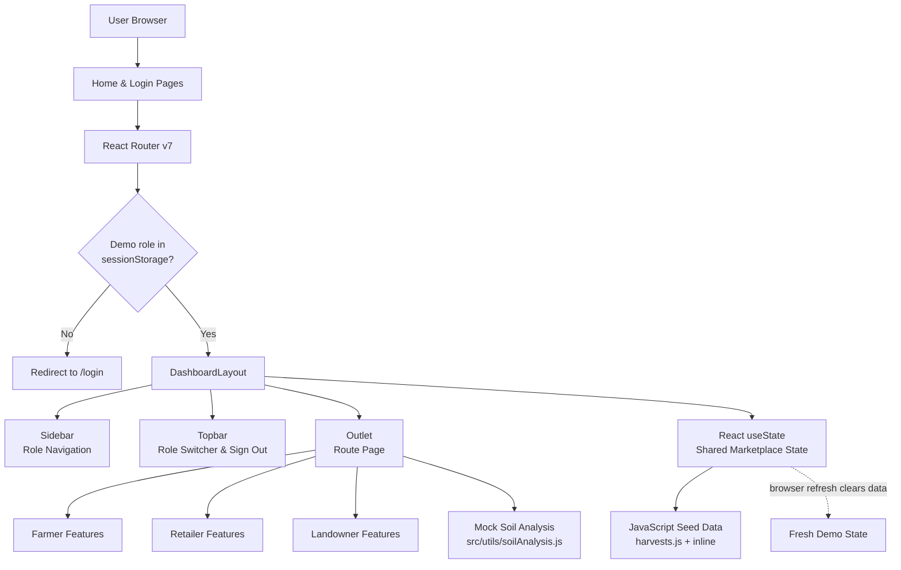
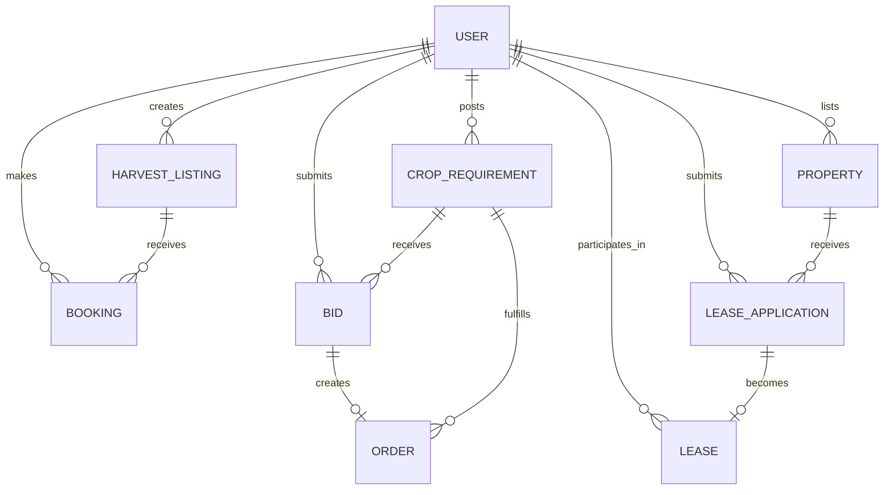

# Farm2Retail

A **frontend-only** agricultural marketplace prototype that connects three user roles — Farmers, Retailers, and Landowners — in a single role-based React application. Users can list and book harvests, manage grow-to-order bids, discover and lease farmland, and explore mock soil intelligence.

> **Project status:** Demonstration prototype. No backend, database, real authentication, payment processing, or persistent marketplace data.

---

## Features

### Farmer
- Create and manage harvest listings with crop details, quantity, price, and harvest date
- View bookings made on listed harvests by retailers
- Browse retailer crop requirements and submit competitive bids
- Discover available farmland and submit lease applications
- Use **Soil Intelligence** for mock soil classification and crop recommendations based on location

### Retailer
- Browse available harvest listings with filtering by category and location
- Book produce quantities from farmers with instant total calculation
- View and cancel active bookings
- Post crop requirements for grow-to-order supply with quality specifications
- Review farmer bids and accept the best offer to create tracked orders

### Landowner
- Create and manage farmland property listings with acreage, rent, soil type, and irrigation details
- Review and approve or reject farmer lease applications
- View active leases with tenant details and lease terms

### Shared Marketplace Workflows
1. **Harvest Pre-Booking** — Farmers list upcoming harvests; retailers pre-book quantities before harvest
2. **Grow-to-Order Bidding** — Retailers post requirements; farmers bid; retailers accept bids to create orders
3. **Farmland Leasing** — Landowners list properties; farmers apply; landowners approve to create leases
4. **Soil Intelligence** — Farmers enter location and area to receive simulated soil classification and crop recommendations

---

## Tech Stack

| Layer | Technology | Version | Purpose |
|-------|------------|---------|---------|
| Framework | React | ^19.2.8 | UI framework |
| | React DOM | ^19.2.8 | React renderer |
| Routing | React Router DOM | ^7.18.4 | Client-side routing |
| Styling | Tailwind CSS | ^4.3.3 | Utility-first styling |
| | @tailwindcss/vite | ^4.3.3 | Tailwind Vite plugin |
| Icons | lucide-react | ^1.59.0 | Icon library |
| Build | Vite | ^8.3.0 | Dev server & production bundler |
| | @vitejs/plugin-react | ^6.1.1 | React Fast Refresh |
| Linting | ESLint | ^10.10.0 | Code quality |

**Language:** JavaScript (.jsx files) only — no TypeScript.
**State Management:** React hooks (`useState`, `useOutletContext`) — no Redux, Zustand, or Context API.
**Data:** Plain JavaScript modules in `src/data/` and `src/layouts/DashboardLayout.jsx` — no mock API library.

---

## Prerequisites

- **Node.js** `^20.19.0` or `>=22.12.0` (required by Vite 8)
- **npm** (included with Node.js)
- **Git**

Verify installed versions:
```bash
node --version
npm --version
```

---

## Installation & Setup

### 1. Clone the Repository
```bash
git clone https://github.com/Rizzwan07/Farm2Retail.git
cd Farm2Retail
```

### 2. Install Dependencies
```bash
npm install
```
No environment file or API key is required — all data is defined in JavaScript source files.

### 3. Start the Development Server
```bash
npm run dev
```
Open the URL printed by Vite (typically `http://localhost:5173/`).

### Windows PowerShell Note
If port 5173 is in use:
```powershell
npm run dev -- --port 5174
```

---

## Running the Application

1. Open the home page and select **Get Started** or **Sign In**
2. Enter any valid-looking email and a password with **at least 6 characters**
3. Select a demo role: **Farmer**, **Retailer**, or **Landowner**
4. Use the dashboard sidebar to navigate features for that role
5. Use the role selector in the topbar to switch workspaces
6. Select **Sign Out** to clear the demo role and return to the login page

**Demo Notes:**
- Any email/password combination works in demo mode
- The selected role is stored in `sessionStorage` under `demoRole`
- Dashboard records are held in React memory and reset on page refresh
- Prices and totals are illustrative — no payment gateway exists

---

## How the Application Works

### Login & Role Access
`Login.jsx` validates the demo form and stores the selected role in `sessionStorage`. `DashboardLayout.jsx` checks for that stored role before rendering dashboard routes and redirects to `/login` when missing.

### Shared Dashboard State
`DashboardLayout.jsx` initializes all marketplace entities with `useState`:
- `harvests`, `bookings`, `requirements`, `bids`, `orders`
- `properties`, `leaseApplications`, `leases`

These values and setters are passed to route pages through React Router's `Outlet` context. This enables actions in one role's workspace to appear immediately in another workspace during the same browser session (e.g., a farmer creating a harvest appears in the retailer's browse view instantly).

### Soil Intelligence
`src/utils/soilAnalysis.js` is a mock adapter that:
1. Maps Indian regions to hardcoded soil types (Black Cotton, Alluvial, Red Loam, Laterite, Sandy Loam, Clay, Peaty)
2. Returns crop recommendations with suitability scores per soil type
3. Adds area-based insights (small/medium/large holdings)
4. Simulates a 1.5–2.5 second analysis delay
5. **Does not** call an AI model, laboratory service, or external API

### Design Tokens
Defined in `src/index.css` under `@theme`:
```css
--color-green-primary: #2D5A27;   /* Forest green */
--color-green-dark:   #1A3A18;    /* Dark green */
--color-green-light:  #4A7C44;    /* Light green */
--color-cream:        #FAF8F5;    /* Warm off-white */
--color-earth-brown:  #8B6914;    /* Earthy accent */
--color-earth-light:  #D4A843;    /* Light earth accent */
--font-sans:          "Inter", system-ui, sans-serif;
```

---

## System Architecture



**All application processing happens in the browser.** The only browser storage used is `sessionStorage` for the selected demo role.

---

## Data Relationships (ER Diagram)

The following describes object relationships in the demo frontend state. **This is not a database schema.**



---

## Main Routes

| Route | Purpose | Role Access |
|-------|---------|-------------|
| `/` | Public landing page | All |
| `/login` | Demo role selection & sign-in | All |
| `/dashboard` | Role-specific dashboard home | All |
| `/dashboard/my-harvests` | Farmer harvest listings | Farmer |
| `/dashboard/browse-harvests` | Retailer harvest search | Retailer |
| `/dashboard/harvest/:id` | Harvest details & booking | Farmer, Retailer |
| `/dashboard/my-bookings` | Farmer view of harvest bookings | Farmer |
| `/dashboard/retailer-bookings` | Retailer booking management | Retailer |
| `/dashboard/crop-requirements` | Retailer crop requirements | Retailer |
| `/dashboard/crop-bids` | Farmer bid submission | Farmer |
| `/dashboard/manage-bids/:id` | Retailer bid management | Retailer |
| `/dashboard/orders` | Grow-to-order tracking | Retailer |
| `/dashboard/my-properties` | Landowner property listings | Landowner |
| `/dashboard/find-farmland` | Farmer farmland search | Farmer |
| `/dashboard/property/:id` | Property details & lease application | Farmer, Landowner |
| `/dashboard/lease-applications` | Lease application management | Landowner |
| `/dashboard/lease-management` | Active lease overview | Landowner |
| `/dashboard/soil-intelligence` | Mock soil analysis | Farmer |

Unimplemented dashboard slugs are handled by `PlaceholderPage.jsx`.

---

## Project Structure

```text
Farm2Retail/
├── public/                         # Static assets
│   ├── favicon.svg
│   └── icons.svg
├── src/
│   ├── components/                 # Reusable UI components
│   │   ├── Sidebar.jsx             # Role-based navigation drawer
│   │   └── Topbar.jsx              # Header with role switcher
│   ├── data/                       # Sample/mock data
│   │   └── harvests.js             # Seed harvest listings + helpers
│   ├── layouts/                    # Page layout shells
│   │   └── DashboardLayout.jsx     # Shared shell + all marketplace state
│   ├── pages/                      # Route-level components
│   │   ├── HomePage.jsx            # Landing page
│   │   ├── Login.jsx               # Demo sign-in with role selection
│   │   ├── DashboardHome.jsx       # Dashboard overview
│   │   ├── MyHarvests.jsx          # Farmer: list/manage harvests
│   │   ├── BrowseHarvests.jsx      # Retailer: search harvests
│   │   ├── HarvestDetails.jsx      # Harvest view + booking
│   │   ├── MyBookings.jsx          # Farmer: view bookings
│   │   ├── RetailerBookings.jsx    # Retailer: manage bookings
│   │   ├── CropRequirements.jsx    # Retailer: post requirements
│   │   ├── CropBids.jsx            # Farmer: bid on requirements
│   │   ├── ManageBids.jsx          # Retailer: review/accept bids
│   │   ├── Orders.jsx              # Retailer: track orders
│   │   ├── MyProperties.jsx        # Landowner: list properties
│   │   ├── FindFarmland.jsx        # Farmer: search farmland
│   │   ├── PropertyDetails.jsx     # Property view + lease apply
│   │   ├── LeaseApplications.jsx   # Landowner: review applications
│   │   ├── LeaseManagement.jsx     # Landowner: view leases
│   │   ├── SoilIntelligence.jsx    # Farmer: soil analysis tool
│   │   └── PlaceholderPage.jsx     # Unimplemented route fallback
│   ├── utils/                      # Helper functions
│   │   └── soilAnalysis.js         # Mock soil intelligence adapter
│   ├── App.jsx                     # Router configuration
│   ├── main.jsx                    # React entry point
│   └── index.css                   # Tailwind import + design tokens
├── index.html                      # HTML entry point
├── vite.config.js                  # Vite + React + Tailwind config
├── eslint.config.js                # ESLint configuration
├── package.json                    # Dependencies & npm scripts
├── AGENTS.md                       # Project development instructions
├── PROJECT_CONTEXT.md              # Verified development state
└── README.md                       # This file
```

---

## Available Scripts

| Command | Description |
|---------|-------------|
| `npm run dev` | Start Vite development server |
| `npm run build` | Create production build in `dist/` |
| `npm run lint` | Run ESLint across .js/.jsx files |
| `npm run preview` | Preview production build locally |

**Before committing:**
```bash
npm run lint
npm run build
```

---

## Customization Ideas

| Area | File | Modification |
|------|------|--------------|
| **Color Theme** | `src/index.css` | Update `@theme` design tokens |
| **Seed Data** | `src/data/harvests.js` | Add/edit harvest listings |
| | `src/layouts/DashboardLayout.jsx` | Modify sample requirements/properties |
| **Soil Logic** | `src/utils/soilAnalysis.js` | Add regions, soil types, crop recommendations |
| **Navigation** | `src/components/Sidebar.jsx` | Add/remove menu items per role |
| **New Pages** | `src/pages/` + `src/App.jsx` | Create component, add Route |
| **UI Components** | `src/components/` | Build reusable components |

---

## Limitations

- **No backend, API, database, server-side session, or real authentication**
- All marketplace data (harvests, bookings, requirements, bids, orders, properties, applications, leases) stored only in React memory — **resets on page refresh**
- Demo role is the only value persisted in `sessionStorage`
- Prices and booking totals are illustrative — **no payment gateway or refund workflow**
- Soil Intelligence uses regional hardcoded mappings and suitability scores — **not a laboratory test or ML model**
- Ending a lease displays a demo alert rather than updating lease state
- Approving a lease application does not update the property's own status field
- No image upload — property/harvest images use external Unsplash URLs

---

## License

MIT License